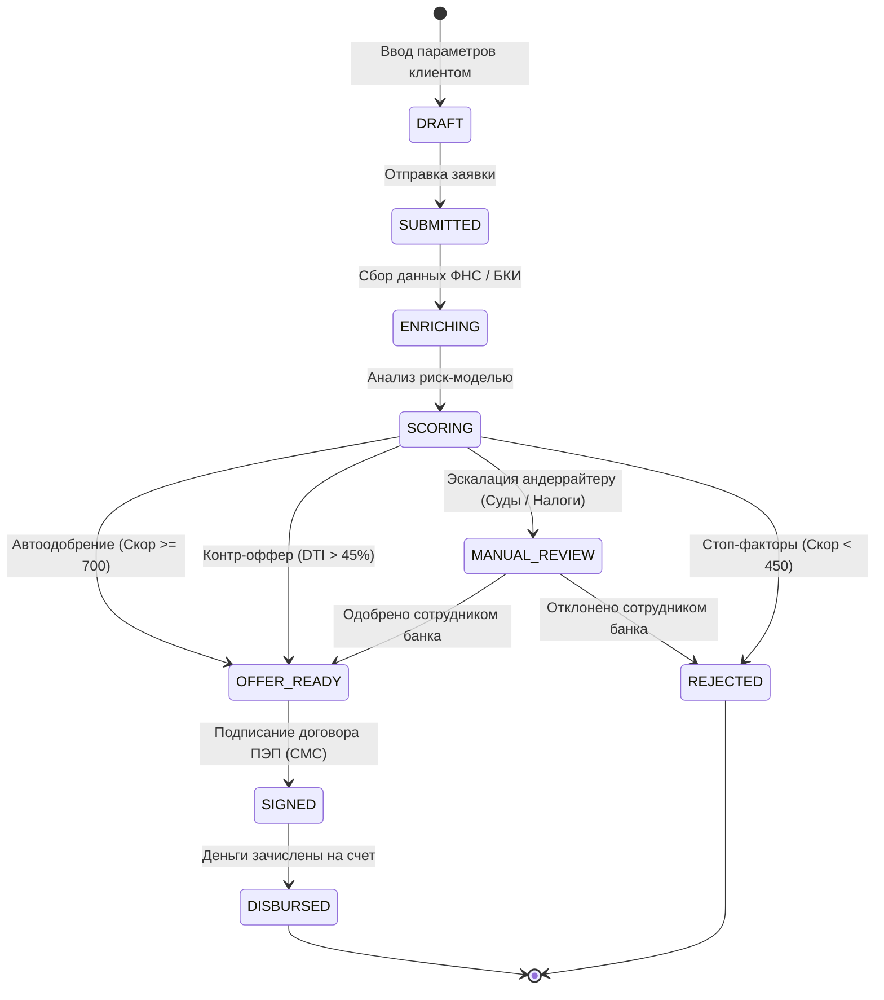

# Альфа Хак 2026 — «Умный кредитный кабинет предпринимателя»

[](https://golang.org)
[](https://react.dev)
[](https://www.docker.com)
[](http://localhost:8080/swagger/index.html)
[](LICENSE)

Прототип цифрового кредитного конвейера для малого и микробизнеса (МСП), объединяющий клиентский путь предпринимателя от подбора продукта до зачисления средств и внутренний контур банка с риск-оценкой и андеррайтингом.

---

## 🚀 Быстрый запуск за 1 команду

Для запуска всего решения (PostgreSQL + Go Backend + React Frontend + Nginx) на любом стандартном ПК выполните:

```bash
make up
```

*(или стандартной командой: `docker compose up --build -d`)*

После завершения сборки откройте в браузере:
* **Веб-интерфейс (Личный кабинет МСП и Банка):** [http://localhost:3000](http://localhost:3000)
* **Интерактивная документация Swagger UI:** [http://localhost:8080/swagger/index.html](http://localhost:8080/swagger/index.html)
* **Healthcheck сервиса:** [http://localhost:8080/api/v1/health](http://localhost:8080/api/v1/health)

Остановить сервисы:
```bash
make down
```

---

## 🎯 Назначение и ключевая ценность решения

1. **Для предпринимателя (МСП):**
   * **Простота без финансового жаргона:** автозаполнение реквизитов организации по ИНН из баз ФНС, понятные параметры кредита.
   * **Прозрачность («Нет черному ящику»):** живой визуализатор этапов конвейера со временем прохождения и объяснимыми факторами скоринга (Explainable UI).
   * **Гибкость решений:** банк не просто отказывает, а делает **встречные предложения (Counter-Offers)** с комфортным платежом.
   * **«Кредитный доктор»:** персональные советы по оздоровлению финансового профиля компании в случае отказа.
   * **Внутрипродуктовое подписание:** подписание договора простой электронной подписью (ПЭП) прямо в интерфейсе без ожидания внешних СМС.

2. **Для Альфа-Банка:**
   * **Автоматизация конвейера (STP / Straight-Through Processing):** автоодобрение надежных заемщиков менее чем за 3 секунды.
   * **Умный Rule & Scoring Engine:** расчет долговой нагрузки (DTI), проверка стоп-факторов (возраст бизнеса < 6 мес., блокировки ФНС, дефолты в БКИ), авторасчет безопасных лимитов.
   * **Кабинет риск-офицера / андеррайтера:** удобная очередь рассмотрения пограничных заявок с полным риск-паспортом заемщика.
   * **Скидка за лояльность:** автоматическая скидка -0.5% к ставке клиентам с расчетным счетом в Альфа-Банке.

---

## 🧪 Пошаговый сценарий проверки для экспертов жюри (E2E)

В интерфейсе предусмотрена вкладка **«Демо-сценарии жюри»**, которая позволяет в один клик протестировать все 4 эталонных ветки кредитного конвейера:

| Сценарий | Тестовый ИНН | Организация | Запрос | Логика конвейера и Результат |
| :--- | :--- | :--- | :--- | :--- |
| **№1. Fast-Track (Автоодобрение)** | `7701234567` | ООО «Вектор Роста» | 5 млн ₽ на 24 мес. | **Скор 920/1000, чистая история, РКО в Альфа-Банке.** Мгновенное одобрение 100% запрошенной суммы со ставкой 14.0% годовых. Доступно моментальное подписание ПЭП и симуляция выдачи. |
| **№2. Встречное предложение (Counter-Offer)** | `7809876543` | ИП Смирнов А.В. | 6 млн ₽ на 12 мес. | **Высокая долговая нагрузка (DTI 47.4%).** Банк не отказывает клиенту, а рассчитывает безопасный лимит (до 4.7 млн ₽) с сохранением комфортного платежа для кассового потока. |
| **№3. Ручной андеррайтинг (Manual Review)** | `5001122334` | ООО «ТехноПром» | 4 млн ₽ на 36 мес. | **Вопросы по ФНС и 2 судебных иска.** Заявка направляется на индивидуальный разбор. Переключитесь во вкладку *«Кабинет банка»*, откройте карточку и согласуйте индивидуальные условия. |
| **№4. Стоп-факторы & Кредитный доктор** | `9705544332` | ООО «СтройГрупп Риск» | 3 млн ₽ на 18 мес. | **Срок бизнеса 3 месяца (< 6 мес.), убыток, долг ФНС 410 тыс. ₽.** Заявка отклонена конвейером. Отображается блок «Кредитный доктор» с рекомендациями по оздоровлению. |

> 💡 **Произвольный ИНН:** Вы также можете ввести любой 10- или 12-значный ИНН — встроенный эмулятор детерминированно рассчитает реалистичные данные компании.

---

## 🏛 Архитектура решения

Подробное описание архитектуры, схемы C4 и модели данных доступно в документе [docs/architecture/ARCHITECTURE.md](docs/architecture/ARCHITECTURE.md).

### Схема кредитного конвейера (FSM):


---

## 🛠 Технологический стек

* **Backend:**
  * **Go (Golang 1.24+)** — надежное ядро кредитного конвейера, FSM и чистая архитектура.
  * **Gin Web Framework** — высокопроизводительный REST API.
  * **PostgreSQL 16 + GORM** — реляционная СУБД с автомиграциями и транзакционным аудитом.
  * **Zero-CGO SQLite Fallback** — автоматическое переключение на локальную БД при запуске без Docker.
  * **Swagger / OpenAPI 3.0** — автогенерируемая интерактивная документация.
* **Frontend:**
  * **React 18 + TypeScript + Vite** — сверхбыстрый SPA.
  * **Tailwind CSS + Lucide Icons** — фирменный дизайн в стиле Альфа-Банка.
* **DevOps:**
  * **Docker & Docker Compose** — многоэтапные минималистичные образы (Alpine Linux).
  * **Nginx** — веб-сервер и reverse proxy.
  * **Makefile** — автоматизация всех стандартных операций.

---

## 📋 Все команды Makefile

```bash
make help          # Показать справку по всем доступным командам
make up            # Собрать и запустить проект в Docker (http://localhost:3000)
make down          # Остановить и удалить контейнеры
make logs          # Просмотр логов сервисов в реальном времени
make status        # Проверить статус контейнеров и healthcheck

make test          # Запуск полного набора Unit и E2E тестов
make test-backend  # Запуск тестов скоринга и FSM
make test-e2e      # Запуск сквозного сценария проверки 4 кейсов

make dev-backend   # Запустить Go бэкенд локально (:8080)
make dev-frontend  # Запустить React фронтенд локально (:3000)
make db-up         # Поднять только PostgreSQL в Docker

make swagger       # Перегенерировать документацию Swagger
make seed          # Наполнить базу синтетическими заявками
make clean         # Очистить временные файлы и тома
```

---

## 📁 Структура репозитория

```
credit_swinki/
├── Makefile                       # Команды сборки, тестирования и развертывания
├── docker-compose.yml             # Конфигурация запуска сервисов (Postgres, Backend, Frontend)
├── THIRD_PARTY_NOTICES            # Описание лицензий библиотек и смоделированных моков
├── README.md                      # Документация проекта
├── docs/
│   ├── architecture/
│   │   └── ARCHITECTURE.md        # C4-схема, FSM, ER-модель, матрица скоринга
│   └── api/
│       ├── openapi.yaml           # Спецификация OpenAPI 3.0
│       ├── swagger.json           # Swagger JSON
│       └── postman_collection.json# Коллекция Postman для тестирования API
├── backend/
│   ├── cmd/server/main.go         # Точка входа HTTP API сервера
│   ├── internal/
│   │   ├── domain/                # Модели данных (Company, Application, Scoring) и FSM
│   │   ├── service/               # Конвейер, Скоринг-движок, Моки ФНС и БКИ
│   │   ├── repository/            # Работа с БД (Postgres / SQLite) и сиды продуктов
│   │   └── handler/               # REST API хэндлеры
│   ├── tests/                     # Unit и E2E автотесты
│   └── Dockerfile                 # Многоэтапный Dockerfile бэкенда
└── frontend/
    ├── src/
    │   ├── components/
    │   │   ├── ClientCabinet/     # Личный кабинет заемщика (Подбор, Таймлайн, Оффер)
    │   │   ├── UnderwriterCabinet/# Кабинет риск-офицера банка и аналитика
    │   │   ├── DemoPanel.tsx      # Экспресс-панель проверки сценариев для жюри
    │   │   └── Header.tsx         # Навигация и индикаторы
    │   ├── api.ts                 # Клиент взаимодействия с REST API
    │   └── types.ts               # TypeScript типы моделей
    ├── nginx.conf                 # Конфигурация Nginx reverse proxy
    └── Dockerfile                 # Многоэтапный Dockerfile фронтенда
```

---

## 🔒 Соответствие ограничениям кейса

* ✅ **Cloud-native запуск:** Все сервисы упакованы в Docker Compose, разворачиваются за одну команду на любом ПК без ручной установки софта.
* ✅ **Только веб-интерфейс:** Полнофункциональный веб-SPA без сторонних мобильных приложений.
* ✅ **Автономность без платных API:** Все внешние контуры (ФНС, ЕГРЮЛ, БКИ, КАД) смоделированы встроенным модулем обогащения.
* ✅ **Внутрипродуктовые коммуникации:** Одноразовые коды подписания выводятся во встроенном защищенном диалоговом окне без внешних SMS/Email.
* ✅ **Объяснимый скоринг:** Прозрачная декомпозиция баллов и факторов влияния для клиента и риск-офицера.
* ✅ **Доступ для жюри:** Доступ к репозиторию открыт для аккаунта `alfa-hack-2026`.
