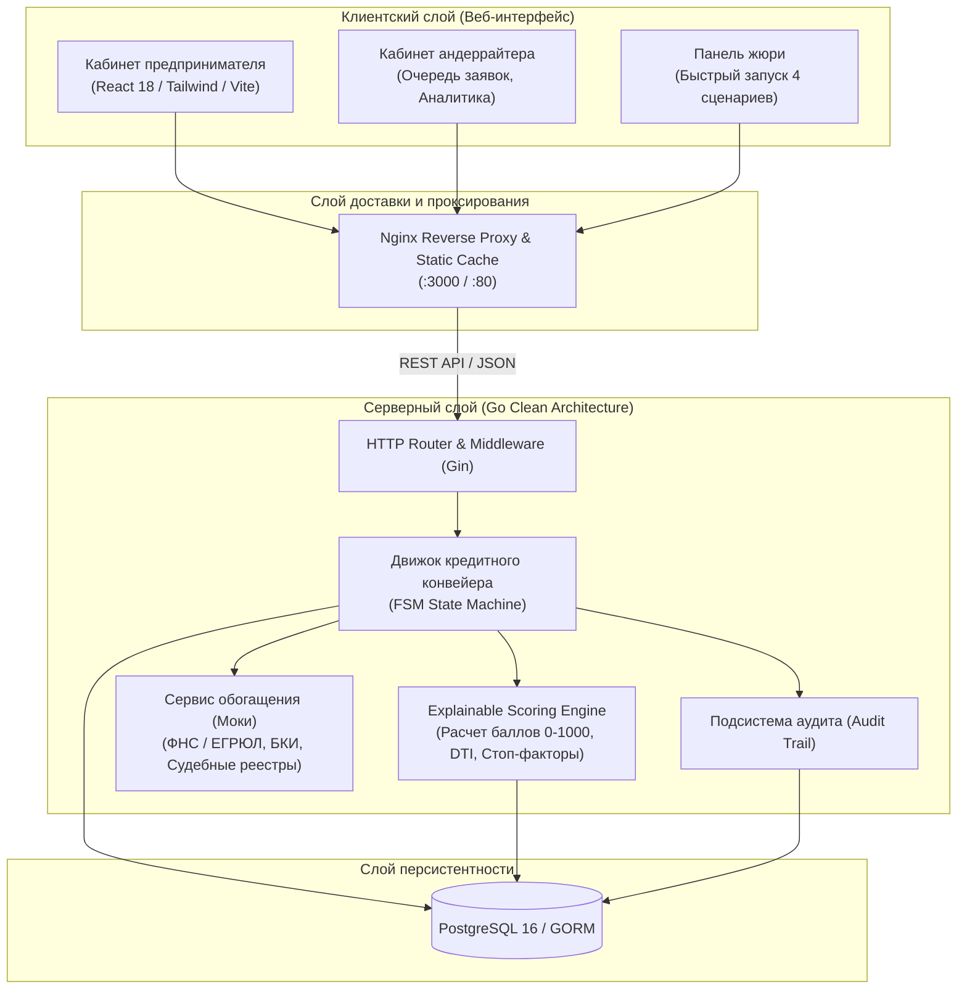
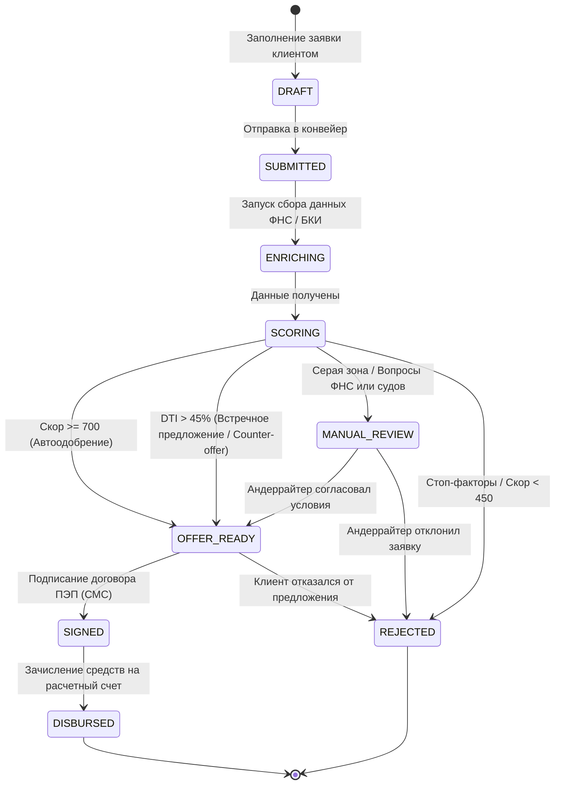
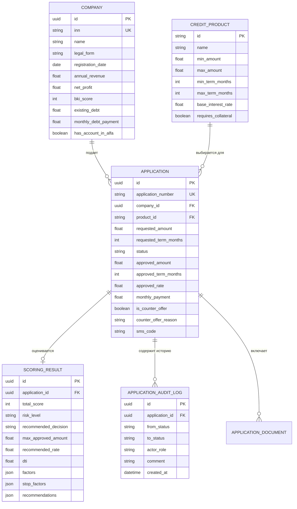

# Архитектурное описание системы «Умный кредитный кабинет предпринимателя»

Документ описывает архитектурные решения, модель состояний, структуру данных и логику принятия кредитных решений конвейера Альфа-Банка.

---

## 1. Архитектурная схема (C4 Component Diagram)

Система построена по принципам Cloud-Native архитектуры с четким разделением клиентского контура, слоя бизнес-логики (конвейер и скоринг) и изолированного слоя данных.

---

## 2. Диаграмма состояний кредитной заявки (FSM)

Жизненный цикл заявки управляется конечным автоматом со строгой валидацией допустимости переходов и обязательным логированием аудита:

---

## 3. Модель данных (Entity Relationship)

---

## 4. Логика скоринга и матрица кредитных решений

### Весовые категории скоринговой модели (0 - 1000 баллов):
1. **Возраст бизнеса (20% веса):**
   * $\ge$ 3 лет: `+100 баллов`
   * 1 - 3 года: `+60 баллов`
   * $<$ 1 года: `-40 баллов`
   * $<$ 6 месяцев: **СТОП-ФАКТОР (Отказ)**
2. **Кредитная история БКИ (25% веса):**
   * БКИ $\ge$ 750: `+160 баллов`
   * БКИ 640 - 749: `+80 баллов`
   * БКИ 550 - 639: `+20 баллов`
   * БКИ $<$ 500: **СТОП-ФАКТОР (Отказ)**
3. **Объем финансирования к выручке (20% веса):**
   * $\le$ 20%: `+100 баллов`
   * 20 - 40%: `+40 баллов`
   * $>$ 40%: `-80 баллов`
4. **Коэффициент долговой нагрузки DTI (20% веса):**
   * DTI $\le$ 35%: `+100 баллов`
   * DTI 35 - 50%: `+30 баллов`
   * DTI $>$ 50%: `-100 баллов`
5. **Клиентская лояльность (10% веса):**
   * Расчетный счет открыт в Альфа-Банке: `+60 баллов` и **скидка -0.5% к ставке**
6. **Судебная и налоговая нагрузка (5% веса):**
   * Задолженность перед ФНС: `-60 баллов`
   * Арбитражные дела: `-40 баллов` за каждое дело

### Дерево решений:
* **Стоп-факторы или скор < 450** $\rightarrow$ `REJECT` (Отказ + персональные рекомендации «Кредитного доктора»).
* **Наличие налоговой задолженности или $\ge 2$ судебных исков** $\rightarrow$ `MANUAL_REVIEW` (Передача кредитному андеррайтеру).
* **Сумма превышает безопасный лимит или DTI > 45%** $\rightarrow$ `COUNTER_OFFER` (Встречное предложение с безопасной суммой).
* **Скор $\ge$ 700 и DTI $\le$ 45%** $\rightarrow$ `APPROVE` (Мгновенное автоодобрение на запрошенных условиях).
